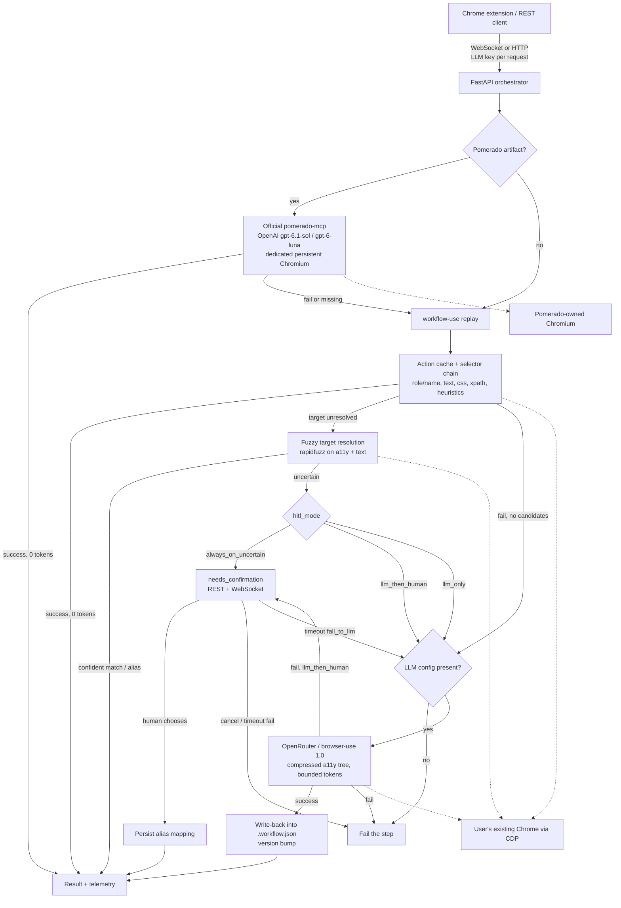

# browser-platform

Backend for building **deterministic, token-cheap, low-latency** browser subagents.

AI is used only when a deterministic step fails. A Chrome extension (later) will attach to this backend; the user’s OpenRouter key stays in `chrome.storage` and is sent **per request**, never stored on the server. Pomerado minting is different: it uses a server-side `OPENAI_API_KEY` (environment only, never written to `.env` or request bodies) with Pomerado's official OpenAI models and hosted tools.

This project is licensed under **AGPL-3.0-or-later** because it integrates [workflow-use](https://github.com/browser-use/workflow-use) (AGPL-3.0) for record and replay.

## Tier order

For each run / step:

1. **Pomerado** — if a minted deterministic tool exists, run it with **no model calls**.
2. **workflow-use replay** — recorded workflow JSON, `selectorStrategies` plus our fallback chain and heuristics. Stagehand-style action cache tries the last winner first. Read-only extract results can be reused briefly. When a step target is still unresolved (for example pick `{name}` from a roster, then `{status}`), **fuzzy target resolution** scores candidate rows/options/labels (a11y tree + visible text) with [rapidfuzz](https://github.com/rapidfuzz/rapidfuzz). It handles name order (`Lewis, Alex` ↔ `Alex Lewis`), Hebrew/RTL and niqqud, diacritics, and typos. A match is accepted only above a high threshold **and** with a clear margin over the runner-up. Uncertain matches pause for a human (or fall through to the LLM, see `hitl_mode`). A confirmed choice is stored as an **alias** so the next run resolves deterministically inside this same tier.
3. **browser-use 1.0 agent (LLM fallback)** — attached to the same Chrome via `cdp_url`. If the agent cannot finish the step, a bounded OpenRouter selector repair (compressed a11y tree, default `qwen/qwen3.7-flash`) runs. On success the winning selector is **written back** into the workflow-use file and the version is bumped, so the next run is deterministic again.



## Extra components (and why)

| Component | Why it is here |
| --- | --- |
| **Stagehand-style action cache** | Reuses the selector that last worked for this step + URL path so repeated runs skip the full fallback chain (lower latency, no tokens). |
| **A11y-tree compression** | Drops generic/empty nodes, deduplicates, truncates. The LLM repair prompt stays small. Also feeds fuzzy target resolution. |
| **Fuzzy target resolution + HITL** | Part of workflow-use replay (not a separate tier, not Pomerado). Scores roster/option candidates; pauses the run when unsure so a mobile/web client can confirm. |
| **Read-only result cache** | Identical extract on the same URL (short TTL) returns immediately. |
| **Playwright MCP extension bridge (stub)** | Reserved WebSocket feature for Playwright MCP `--extension` so we can later reuse the user’s logged-in tabs / SSO without a second browser. |
| **CDP attach contract** | Connect to the user’s already-open Chrome. Never close foreign tabs, never clear cookies or site data. |
| **Create workflow from a task** | Second authoring path besides Pomerado mint / a pre-recorded `.workflow.json`. browser-use 1.0 demonstrates the task once on the user's Chrome; we capture actions with multi-strategy selectors, generalize inputs into `{variables}`, save a workflow-use 0.2.x document, and immediately replay it with **0 tokens**. |
| **Stock Pomerado MCP** | Minting uses official `pomerado-mcp mint` with `OPENAI_API_KEY` from the server environment (default models `gpt-6.1-sol` / `gpt-6-luna`, native Responses API, hosted tools such as `apply_patch`). A dedicated persistent Chromium (its own profile dir, port 9333, never the user's Chrome) stays running so logins persist. Each published tool is registered as a workflow and shows up in the phone app's Workflows list. browser-use, repair, from-task, and HITL still use the per-request OpenRouter key. |

## Stack

- **Orchestrator:** Python 3.11+ FastAPI
- **Record / schema / replay:** official workflow-use 0.2.11 `WorkflowDefinitionSchema` is used to ingest recorded JSON. Replay against the user’s Chrome is the platform Playwright CDP executor (`selectorStrategies` + fallbacks). Stock `run_with_no_ai` cannot be imported alongside browser-use 1.0.8 (`SystemMessage` / `BrowserProfile` were removed).
- **Minted tools:** official `pomerado` (0.4.0-canary) via `pomerado-mcp` (`node_host/src/stock-mcp.mjs`). Minting uses the server `OPENAI_API_KEY` and Pomerado's default models (`gpt-6.1-sol` minter, `gpt-6-luna` Guardian) with hosted tools. Runs make **no model request**. Sessions attach to a dedicated persistent Chromium at `http://127.0.0.1:9333` (profile under `data/pomerado-chromium-profile`), not the user's Chrome. A published integration is saved under `data/integrations/` and registered as a platform workflow.
- **LLM repair:** [browser-use 1.0.8](https://github.com/browser-use/browser-use) `Agent` + `Browser(cdp_url=...)` + `ChatOpenAI` at `https://openrouter.ai/api/v1`, then OpenRouter selector repair as a fallback. Write-back on success.
- **Browser:** the user’s existing Chrome at a CDP URL (`chrome://inspect/#remote-debugging`, later `chrome.debugger` relay)

Default repair model: `qwen/qwen3.7-flash`. Alternative: `openai/gpt-oss-20b`.

## Pomerado minting (OpenAI)

Pomerado is invoked the stock way: `pomerado-mcp mint --root <data>/integrations`, official default models, hosted tools, `OPENAI_API_KEY` from the process environment. Set that variable in the environment of the backend process; do **not** put it in `.env`, the repo, or the Windows zip.

- Minter: `gpt-6.1-sol`. Guardian: `gpt-6-luna`.
- A dedicated Chromium is auto-launched on port **9333** with a persistent profile (`data/pomerado-chromium-profile`) and is left running between mints and runs.
- `POST /api/pomerado/mint`, then `GET /api/pomerado/jobs` or `GET /api/pomerado/jobs/{id}` (includes a `trace` of timestamped steps). Progress is also streamed on `/ws/runs` as `mint_updated` / `mint_step` / `mint_finished`. Secrets are redacted. When the build is `published`, the tool is registered as a workflow and appears in the phone website's **Workflows** list, with a link back to the mint trace. Running it uses the Pomerado tier first (0 LLM tokens) on the same Chromium.
- browser-use, selector repair, from-task, and HITL continue to use the per-request OpenRouter key.

`POMERADO_OPENAI_SPEND_CAP` (USD) optionally stops further OpenAI calls once the cap is reached. Usage is taken from response metadata.

## Phone remote (auto tunnel URL)

The phone web app at [https://browser-platform-web.vercel.app](https://browser-platform-web.vercel.app) reads `/backend.json` on load and again if a request fails, so you do not have to paste a new Cloudflare quick-tunnel URL when it restarts. Leave **Backend URL** empty (or leave a `*.trycloudflare.com` URL); only set a custom URL if you are pointing at something else. The OpenRouter key still lives in the phone's localStorage (used for from-task, repair, and browser-use — not for Pomerado minting).

A watchdog (`scripts/tunnel_watchdog.py`) probes the tunnel every 30s, restarts `cloudflared` when the edge drops, updates `/etc/hosts`, and republishes `/backend.json`.

## Windows quick start

1. Unzip `browser-platform-windows.zip` to a folder you can keep (for example `Documents\Browser Platform`).
2. Double-click `start.bat` (it runs `install.ps1` with `ExecutionPolicy Bypass`). The first run installs Python via `uv` (no admin), Node.js LTS per-user if Node is missing (winget `--scope user`, or a portable Node zip under `%LOCALAPPDATA%\BrowserPlatform\runtime\node`), official Pomerado in `node_host` (`npm install`), and Playwright Chromium, then creates a Desktop shortcut named **Browser Platform**.
3. When the page opens at [http://localhost:8745](http://localhost:8745), open **Settings**. Paste an **OpenAI key** for Pomerado minting — it is stored only on this computer under `%LOCALAPPDATA%\BrowserPlatform\secrets`, never in the zip, `.env`, or logs. Paste an **OpenRouter key** for from-task, repair, and browser-use — that one stays in this browser’s `localStorage`. The local UI talks to the backend at this page’s origin; you do not need `backend.json` or a tunnel.

That’s it. No Cloudflare tunnel or watchdog is started on Windows. If nothing is already listening on port 9222, the app starts your installed Chrome with a dedicated profile at `%LOCALAPPDATA%\BrowserPlatform\chrome-profile`. Pomerado uses its own persistent Playwright Chromium (not that Chrome). Workflows live in `%LOCALAPPDATA%\BrowserPlatform\data` so they survive upgrades. To update later, unzip a newer zip over the same folder and double-click `start.bat` again (or run `install.ps1 -Update` if you have set an update URL).

## How to run

```bash
cd /workspace/browser-platform
python3 -m venv .venv
source .venv/bin/activate
pip install -e ".[dev]"
# Playwright is used only as a CDP client; no browser download is required if Chrome is installed.

# Optional: workflow-use / browser-use packages
# pip install -e ".[workflowuse,browseruse]"

# Terminal 1 — start the orchestrator
python -m browser_platform --port 8745

# In Chrome: open chrome://inspect/#remote-debugging and enable it (once).
# Terminal 2 — create and run a workflow (key is request-scoped)
curl -s http://127.0.0.1:8745/health
curl -s -X POST http://127.0.0.1:8745/api/workflows \
  -H 'content-type: application/json' \
  --data @examples/example_com.workflow.json
# Examples: examples/example_com.workflow.json, examples/wikipedia_search.workflow.json
# Live public-site smoke (uses OPENROUTER_API_KEY if set; never prints the key):
#   python scripts/live_smoke.py

curl -s -X POST http://127.0.0.1:8745/api/workflows/<id>/run \
  -H 'content-type: application/json' \
  -d '{"cdp_url":"http://127.0.0.1:9222","llm":{"api_key":"sk-or-v1-...","model":"qwen/qwen3.7-flash"}}'
```

Tests:

```bash
pytest -q
```

The e2e smoke test launches a local Chromium with `--remote-debugging-port` (stand-in for your Chrome), reads the heading on example.com, and fills a public-style search form on a local fixture page. From-task authoring is covered with a scripted demonstration on `tests/fixtures/from_task_form.html` (no live key) plus unit tests for selectors and variable generalization. The LLM path is covered with a **mocked** OpenRouter client.

## How the extension will connect

1. The user pastes an OpenRouter key and picks a model on the extension options page. The key is stored in **`chrome.storage.local` only**.
2. The extension opens **`ws://127.0.0.1:8745/ws/extension`** (or a configured URL). v1 accepts the socket, advertises features, and stubs CDP relay / Playwright MCP bridge messages.
3. Until the `chrome.debugger` relay is implemented, the backend attaches with Playwright `connect_over_cdp` to the browser’s remote-debugging port.
4. Runs are started with `POST /api/workflows/{id}/run`. The body may include `llm.api_key` and `llm.model` for OpenRouter paths (browser-use / repair). Pomerado minting uses only the server `OPENAI_API_KEY`. Keys are **never written to run JSON, workflow files, `.env`, or logs**.
5. Recording: use the **workflow-use** Chrome extension / `create-workflow` CLI, then `POST /api/workflows` with the resulting `.workflow.json`. Or create a workflow from a natural-language task: `POST /api/workflows/from-task` (browser-use demonstrates it once, then a 0-token replay validates the document). `GET /api/recorder` documents both paths.

### REST surface

| Method | Path | Purpose |
| --- | --- | --- |
| GET | `/health` | Liveness |
| GET | `/api/catalog`, `/api/catalog/{id}` | Public catalogue of published workflows for the end-user run site (no access token) |
| POST/GET/PUT | `/api/workflows` | Create / list / update / fetch a workflow-use document |
| PUT | `/api/workflows/{id}/published` | Admin toggle: show or hide a workflow on the end-user run site. Existing workflows default to published. |
| DELETE | `/api/workflows/{id}` | Delete a workflow (requires the access token when one is configured). Clears result and action caches and version snapshots; past run records are kept and flagged `workflow_deleted` |
| POST | `/api/workflows/from-task` | Create a workflow from a natural-language task (browser-use demo + 0-token replay). `wait: false` returns a job immediately |
| GET | `/api/workflows/from-task/{job_id}` | Poll a from-task job (status, creation vs replay tokens/time, saved workflow) |
| POST | `/api/workflows/from-task/{job_id}/confirmation` | Resume if the job needs variable confirmation or the agent asks a human |
| POST | `/api/workflows/{id}/run` | Run against the user’s Chrome |
| GET | `/api/runs`, `/api/runs/{id}` | Telemetry (per-step latency, tokens, which tier resolved it). When paused, `status` is `needs_confirmation` and `confirmation` holds the prompt payload. |
| GET | `/api/runs/{id}/confirmation` | Pending confirmation prompt (top-N candidates, scores, optional screenshots) |
| POST | `/api/runs/{id}/confirmation` | Resume with a chosen candidate, or cancel |
| POST | `/api/pomerado/mint` | Mint a tool with official Pomerado + OpenAI (server key; no request key). On publish, a workflow is registered automatically. |
| GET | `/api/pomerado/jobs/{id}` | Poll a mint job |
| WS | `/ws/extension` | Future extension + CDP / Playwright MCP bridge |
| WS | `/ws/runs` | Live run events, including `needs_confirmation` (optionally `?run_id=`) |


## Create a workflow from a task

This is the second creation path, besides minting a Pomerado tool or ingesting a recorded `.workflow.json`.

1. `POST /api/workflows/from-task` with a natural-language `task`, optional `variables` (for example `{"query":"browser automation"}`), optional `start_url`, the user’s `cdp_url`, and a request-scoped `llm` (`api_key` + `model`). The key is never stored.
2. A browser-use 1.0.8 agent runs the task **once** on the already-open Chrome (CDP, no foreign-tab close, no site-data reset).
3. The platform records every navigation, click, input, select, and extract, and builds `selectorStrategies` from the live element (a11y role/name, text, CSS, XPath).
4. Typed values that match provided variables or `{placeholders}` in the task become workflow inputs. Other literals can be suggested as variables; if `confirm_variables` is on (the default when values were not provided), the job pauses with `status: "needs_confirmation"` and `kind: "variables"` so a client can accept or rename them. The same broker is used if the agent itself asks a human.
5. The result is saved as a workflow-use 0.2.x JSON document in the store (it always ends with `extract`).
6. After recording, the step list is **compacted**: redundant and back-and-forth navigations and steps not on the causal path to the final extract (menu checkbox toggles, 1–2 character junk inputs) are dropped, consecutive fills of the same field are merged, and a navigation whose URL already embeds a `{variable}` (for example a search-results or article URL) is preferred over typing a search. An optional cheap single LLM pass may further prune the list; those tokens are counted toward creation cost. The job result persists `creation.tokens_in`, `tokens_out`, `cost_usd`, `steps_before`, `steps_after`, and compaction stats.
7. The demonstration CDP session is dropped, then the new workflow is **immediately replayed deterministically** in a **fresh tab** (no LLM, 0 tokens; optional `replay_variables` to prove fills are not leftover page state). The job reports creation tokens/time vs replay tokens/time. Typing is captured even when the agent sets values via CDP `Input.insertText` or JavaScript (no `input` events), by hooking value setters and snapshotting form fields.

`wait: true` (default) blocks until creation + replay finish. `wait: false` returns `{id, status: "running"}` immediately; poll `GET /api/workflows/from-task/{job_id}` or subscribe to `/ws/runs`. Resume a variable / agent prompt with:

```http
POST /api/workflows/from-task/{job_id}/confirmation
Content-Type: application/json

{"action":"confirm","variables":{"email":"user@example.com"}}
```

Example body:

```json
{
  "task": "Search Wikipedia for {query}, open the first result, and extract the first paragraph.",
  "variables": {"query": "browser automation"},
  "cdp_url": "http://127.0.0.1:9222",
  "llm": {"api_key": "sk-or-v1-...", "model": "qwen/qwen3.7-flash"},
  "wait": false
}
```

A local form fixture used in tests lives at `tests/fixtures/from_task_form.html` (copied under `examples/fixtures/`).

## Deterministic replay (no in-run LLM)

When a saved workflow runs, every step is resolved deterministically (recorded selectors, aliases, and — unless `strict` is on — confident fuzzy match). A step that cannot be resolved fails by name, or the run returns `needs_input` when a required or closed value is missing or unknown.

In-run LLM repair and `browser-use` agent fallback are **kept in the codebase but hard-disabled**. They are not available as a per-run, per-workflow, API, chat, or extension flag. The only switch is the server environment variable `BROWSER_PLATFORM_ALLOW_IN_RUN_REPAIR` (default `false`). LLM use remains allowed in the chat orchestration layer (planning, choosing tools, answering) and at authoring time (`from-task`, explore naming, recording cleanup).

## Human-in-the-loop confirmation (mobile / web app)

Fuzzy target resolution lives **inside workflow-use**, not in Pomerado and not as its own tier. Start a run with `wait: false` so the HTTP request returns immediately, then subscribe to events and render a confirmation card when the run pauses.

### Workflow / step options

Set these on the workflow or on an individual step (step wins). Platform defaults come from `BROWSER_PLATFORM_FUZZY_*` and `BROWSER_PLATFORM_HITL_*`.

```json
{
  "fuzzy": { "enabled": true, "threshold": 90, "margin": 8, "top_n": 5, "include_screenshot": false },
  "hitl": { "mode": "always_on_uncertain", "timeout_s": 300, "timeout_policy": "fail" },
  "steps": [
    { "type": "click", "fuzzy_query": "{name}", "target_text": "{name}" },
    { "type": "select_change", "fuzzy_query": "{status}", "selectedText": "{status}", "container_hint": "tr.selected" }
  ]
}
```

- `threshold` / `margin` are rapidfuzz scores on a 0–100 scale. A candidate is accepted automatically only if `score >= threshold` **and** (`score - runner_up) >= margin`.
- `hitl_mode`:
  - `always_on_uncertain` (default) — pause for a human when the match is below threshold or the margin is tight. API and other unattended clients must pass `"interactive": true` to pause; otherwise the step fails clearly.
  - `llm_then_human` — if in-run repair is enabled (see below), try it first; if that fails, pause for a human.
  - `llm_only` — never pause; go to the LLM repair path only when in-run repair is enabled.
- `timeout_policy`: `fail` the step, or `fall_to_llm` when the confirmation window expires (repair still requires the server flag).
- `include_screenshot`: if `true`, each of the top-N candidates may include a `screenshot` data-URL (`data:image/png;base64,...`).
- After a human confirms, the choice is saved on the workflow as `aliases[]` (`query`, `query_normalized`, `chosen_text`, optional `cssSelector`). The next run with the same step + query resolves inside workflow-use (`resolution: "alias"`) without pausing.

An example roster workflow (10 people + status dropdown) is in `examples/attendance.workflow.json` with the page at `examples/fixtures/attendance.html` (same file under `tests/fixtures/`).

### Recommended client flow

1. `POST /api/workflows/{id}/run` with `"wait": false`, `"interactive": true` (so an uncertain click can pause for confirmation instead of failing), and the declared variables (for example `term`). Required inputs are listed on the phone **Run** screen with clear labels (Wikipedia: **Search term**). Last-used values are remembered in the phone's localStorage; a run is rejected until required fields are filled — defaults are not applied silently.
2. Open `WS /ws/runs?run_id={run_id}` (or poll `GET /api/runs/{run_id}`).
3. When `status` is `needs_confirmation` (event type `needs_confirmation`), render the prompt.
4. `POST /api/runs/{run_id}/confirmation` with the user’s choice, then wait for `run_resumed` / a terminal status.

### `needs_confirmation` event

```json
{
  "type": "needs_confirmation",
  "run_id": "…",
  "workflow_id": "…",
  "workflow_name": "attendance_mark",
  "step_index": 1,
  "step_type": "click",
  "step_description": "Pick the attendee",
  "query": "Ann Cohen",
  "reason": "ambiguous_margin",
  "threshold": 90,
  "margin": 8,
  "winner_score": 94.74,
  "runner_up_score": 94.74,
  "top": [
    { "id": "c6", "text": "Anna Cohen", "role": "row", "selector": "tr[data-name=\"Anna Cohen\"]", "score": 94.74, "screenshot": null },
    { "id": "c7", "text": "Anne Cohen", "role": "row", "selector": "tr[data-name=\"Anne Cohen\"]", "score": 94.74 }
  ],
  "timeout_s": 300,
  "timeout_at": "2026-11-24T01:30:00+00:00",
  "timeout_policy": "fail",
  "hitl_mode": "always_on_uncertain",
  "resume": { "method": "POST", "path": "/api/runs/{run_id}/confirmation", "body": { "action": "confirm", "candidate_id": "<id from top>" } },
  "cancel": { "method": "POST", "path": "/api/runs/{run_id}/confirmation", "body": { "action": "cancel" } }
}
```

`reason` is `below_threshold` or `ambiguous_margin`. Per-step telemetry uses `tier: "workflow_use"` with `resolution` set to `fuzzy`, `alias`, or `hitl`.

### Resume / cancel

```http
POST /api/runs/{run_id}/confirmation
Content-Type: application/json

{"action": "confirm", "candidate_id": "c6"}
```

You may send `"text": "Anna Cohen"` instead of `candidate_id`. To abandon the run:

```json
{"action": "cancel"}
```

A confirm or cancel against a run that is not waiting returns **409**. Auth is the same access token as the rest of the API (`X-Browser-Platform-Token` / `Authorization` / `access_token` query).


## End-user run site

The admin site at [browser-platform-web.vercel.app](https://browser-platform-web.vercel.app) is for creating, exploring and publishing workflows. End users use a separate site, [browser-platform-run.vercel.app](https://browser-platform-run.vercel.app):

- Browse and search published workflows
- Fill in inputs (explore-mode optional defaults are pre-filled)
- Click Run — the site asks the installed Chrome extension to confirm, then the workflow runs in the user's own browser session
- Progress, results and per-browser run history stay on the user's device

Unpublished workflows stay on the admin site only. The extension must allow `https://browser-platform-run.vercel.app` (`externally_connectable` and the web-bridge content script).

This is a separate Vercel project so the authoring UI is never shipped to end users.

## Chrome extension (workflow-use replay)

A Manifest V3 extension in `extension/` replays workflow-use automations in your current Chrome tab (no LLM, no Pomerado, no local server required to run). It can list/install packages from the private Marketplace. Chrome Web Store publishing is not done yet. Build it from source with `cd extension && npm install && npm run build`, then use **Load unpacked** on `chrome://extensions` and select `extension/dist` (see `extension/README.md`). The built `extension/dist` folder is not committed.

## Marketplace

The phone website at https://browser-platform-web.vercel.app has a Marketplace tab for publishing, browsing, and installing automations (workflow-use, from-task, and Pomerado tool packages). Listings are private: the same shared access token used for the phone site is required to list, publish, or download (`X-Browser-Platform-Token` or `Authorization: Bearer`). Each listing stores name, description, type/tier, declared inputs, version, created date, and the sha256 of the package zip. Pomerado (and other code) packages show a one-line warning that they contain executable automation code.

To publish a workflow-use or from-task automation, open the **Market** tab, pick one of your automations from the Publish dropdown, and tap **Publish**. Name, description, type, and inputs are filled in from the workflow and can be edited. Already-published automations show **Update** (the server bumps the version). The Workflows list and detail pages also have a **Publish to marketplace** button that opens this form. You do not need to upload a zip for those types — the server packages the workflow JSON. Pomerado tools still require a zip (they include integration code). The Chrome extension has the same Publish dropdown for installed or imported workflows (learned HITL aliases are included).

Server API (Vercel Functions + private Vercel Blob):

- `GET /api/market` — list listings
- `POST /api/market` — publish a workflow as JSON (`workflow`, `definition`, or `steps`; name/description/inputs optional) or, for Pomerado only, a zip (`multipart` `package` or JSON `package_base64`)
- `GET /api/market/{id}` — listing metadata
- `GET /api/market/{id}/package` — download the zip (hash is verified)
- `DELETE /api/market/{id}` — delete listing and package

Republishing the same listing id bumps the version unless the request already sends a greater version. Installing a package into the local Windows/Linux app is not wired up yet; the Chrome extension can install workflow-use and from-task listings.

## License

AGPL-3.0-or-later. See [LICENSE](LICENSE). workflow-use is AGPL-3.0. browser-use and Pomerado (current) are MIT and used as optional/sidecar components.
